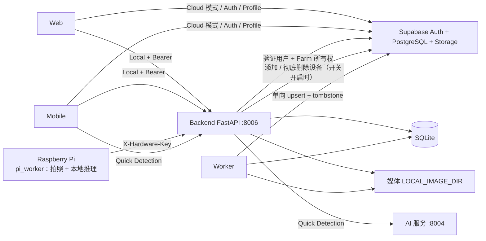

# 系统架构

[返回 README](../README.md) · [数据与同步](DATABASE_AND_SYNC.md) · [Pi Worker](PI_WORKER.md)

## 模块职责（`backend/app/`）

| 模块 | 职责 |
|---|---|
| `auth.py`、`farm_access.py` | 验证 Supabase Token；把用户拥有的 Farm 映射为请求级行过滤（`authorized_db`） |
| `routers/devices.py` | 设备列表 / 详情 / 历史 / 图片 / 告警；设备增删改；历史删除；创建命令 |
| `routers/hardware.py` | Pi 接口：心跳、监测配置、是否到点、领取命令、上传结果、完成 / 失败 |
| `routers/settings_storage.py` | 监测设置、通知设置 |
| `services/device_management.py` | 设备规则：编号全局唯一、只能改名、软删除、彻底删除 |
| `services/device_cloud.py` | 设备的同步云端写入（开关 `DEVICE_CLOUD_WRITE_ENABLED`） |
| `services/detection_deletion.py` | 删除图片 / 记录；30 天图片保留 |
| `services/hardware_commands.py` | 命令生命周期：原子领取、条件完成、超时失败、防重复 |
| `services/monitoring_schedule.py`、`monitoring_lease.py` | 是否到采样时间；同一时段只交给一个调用者 |
| `services/inference_media.py`、`detection_pipeline.py`、`free_range_accumulator.py` | 保存检测和图片、Warning 连续判断与告警、Free-range 快照聚合 |
| `services/core_data.py` | 设备状态、最新结果、历史、Dashboard |
| `services/quick_detection_service.py`、`quick_deletion.py` | 手机 Quick Detection |
| `services/be04_worker.py`、`process_lock.py` | 云同步 Worker；跨平台单实例锁 |

`scripts/`：`start_backend.py`（预检 + 启动）、`start_worker.py`、`build_demo_pack.py`、`migrate_device_code_unique.py`。

## 主要数据流

**Run Detection Now**：Web / Mobile `POST /devices/{id}/commands` → Pi 轮询 `commands/claim` 原子领取 → Pi 拍照、本地推理 → 上传 `.../detection` → Backend 保存 Detection 和图片、命令 completed → Mobile 自动轮询、Web 刷新后显示新记录。超时和重试见 [PI_WORKER](PI_WORKER.md)。

**自动监测**：Pi 问 `monitoring-due`（Backend 按 Farm 时区和监测设置判断，并占住该时段）→ 到点则拍照推理 → `monitoring-samples`。Cage 每个样本生成一条 scheduled Detection；Free-range 样本在内存中按快照间隔聚合，生成正式 `free_range_snapshot`。Warning 需要连续两次达到阈值。

**设备管理**：见 [DEVICE_MANAGEMENT_API](DEVICE_MANAGEMENT_API.md)。

## Local 与 Cloud 访问

Local：带 Bearer 的 Backend 请求 → Supabase 验证 Token → 用该 Token 查询用户拥有的 Farm → 与本地 Farm 取交集 → 只返回这些 Farm 的数据。图片也需要认证。

Cloud：Web / Mobile 直接用 Supabase SDK 读（RLS + 签名 URL），只读；写操作都需要 Local Backend，界面上相应按钮在 Cloud 模式下隐藏。

用户没有 Farm 时看到空列表；Supabase 验证失败不会回落为匿名。

## 进程与状态

- Backend 只运行一个进程。监测时段占位和 Free-range 聚合在内存中；重启后丢失是安全的（下一次询问重新判断）。
- 30 天保留和超时命令检查由 Pi 心跳触发，没有单独的调度进程。
- Worker 是独立进程，每个数据库一个。

## 边界

Backend 不负责 TLS、守护进程或公网暴露。远程 Quick Detection 需要另行批准的安全入口。Pi 的开机自启尚未提供。
