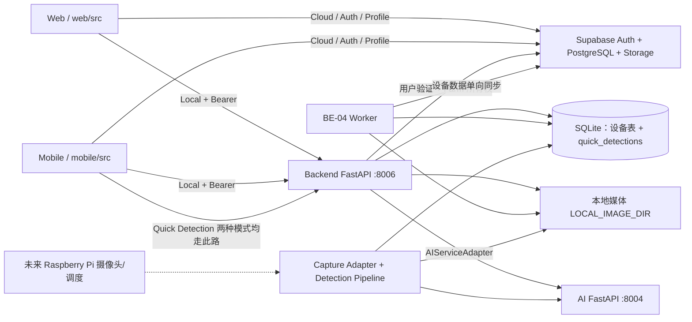
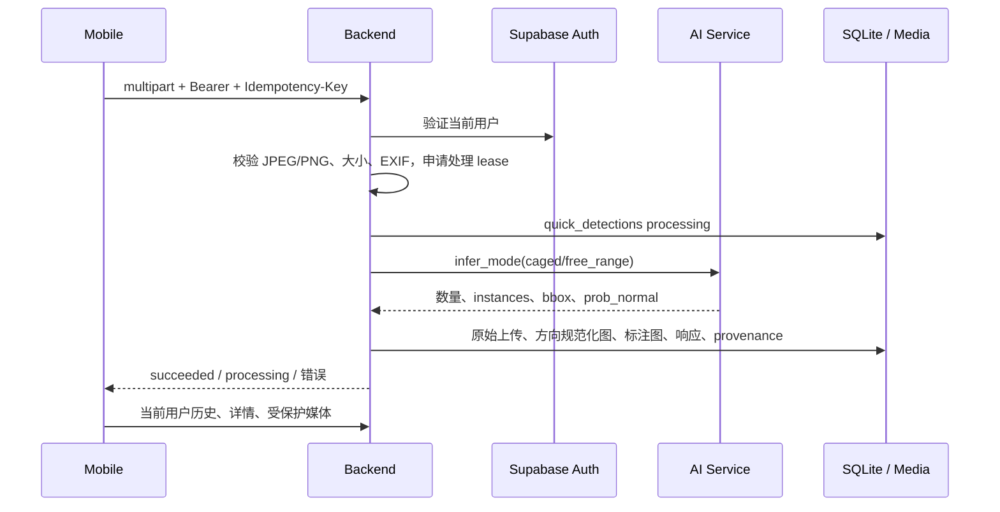

# 系统架构

[返回 README](../README.md) · [数据与同步](DATABASE_AND_SYNC.md)

## 模块职责

- `web/src/App.tsx` 与 `mobile/src/app/`：路由、登录保护、页面。API Client 选择 Local/Cloud，账户变化时清空展示并拒绝过期请求结果。
- `backend/scripts/start_backend.py`：显式环境加载、只读预检、启动所有现有 Router，禁用 legacy 自动初始化。
- `backend/app/auth.py`：向 Supabase 验证实际 Access Token；`farm_access.py` 将真实 Farm 所有权映射为本地请求 Session 的行过滤及写入检查。
- `backend/app/services/core_data.py`：设备状态、最新结果、历史及 Dashboard；`detection_pipeline.py`：检测落库、阈值连续性和告警。
- `capture_adapter.py`：已有 Test File Capture 和未配置边界，不是已完成的 Pi 驱动。
- `ai_adapter.py`、`inference_media.py`、`detection_annotations.py`：调用真实 AI，校验结果，保存同记录原图及标注图。
- `quick_detection_service.py`、`quick_deletion.py`：独立手机检测、幂等和失败恢复、所有者媒体清理，不更新设备业务状态。
- `be04_worker.py`：既有设备数据同步实现；标准 `start_worker.py` 只统一配置和预检，不改变同步规则。

## Local 与 Cloud 访问路径

Local：登录用户 → 带 Bearer 的 Backend 请求 → Supabase Auth 实时验证 → 使用用户 Token 查询其拥有的 Farm → 与本地 Farm UUID 取交集 → 查询 Device/Detection/Alert/Media。图片也需要认证，不是公开静态目录。

Cloud：Web/Mobile `be04CloudApi.ts` → Supabase Auth/REST/Storage → 当前用户 Farm 过滤和 RLS → 短期签名媒体。默认不经过 Backend 的 `/cloud` 代理。`BE04_CLOUD_READ_ENABLED` 只控制可选 Backend 代理及 `/sync/status`，不控制前端直接 Cloud 模式。

两条路径都不把 Demo UUID 当登录身份。用户不拥有 Farm 时为空；Supabase 验证失败不自动回落匿名。当前缓存/请求清理不能使已经发出的 Storage 签名 URL 立刻失效，签名 URL 在过期前仍需当敏感链接处理。

## Quick Detection 独立数据流

同用户相同 request ID 是同一逻辑请求；换内容/模式/来源会冲突。原始字节保留用于 SHA-256，显示原图可能是纠正方向后的版本，以与框坐标一致。失败保留失败状态并清理未完成媒体；不确定提交时不能误删已提交结果。

## 离线与同步

内部设备采集、AI 推理、SQLite 落库不经过交互用户 Session，可按已有服务设计离线工作；但当前没有已验收的常驻 Pi 调度/摄像头系统。Worker 可以持续运行并在恢复网络后重试，断网时无法完成云端上传，不能称为离线同步成功。用户在 Local 中登录或读取受保护 API 仍需 Supabase 联网验证。

Worker 按 Farm→Device→Detection→Alert 同步，图片在记录发布前上传，使用稳定 UUID/对象路径、指纹和重试账本。Quick Detection 不进入该流程。详见数据文档。

## 硬件及交付边界

Raspberry Pi 后续需要实际 Capture Adapter、心跳、采集调度、Free-range 正式聚合/快照、视频存储生命周期、现场资源限制与网络故障验证。现有 DeviceCommand/VideoSegment 表不等于已有命令消费者或录像服务。不得把多帧识别直接当作独立个体总数。

已有软件入口不负责 TLS、服务守护、外网暴露或自动部署。远程 Quick Detection 需要另行审批的安全 Backend 网络入口。
